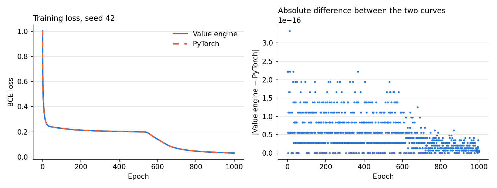

# Lab 5 — Frameworks and Automatic Differentiation

## Goal

Build a small scalar automatic-differentiation engine, prove that it gives
the same gradients as PyTorch, train a tiny network on it, and then use
PyTorch to look at what a real framework does: computation graphs, eager
vs compiled execution, and tensor memory layout.

Sections marked **Measured** contain numbers from my runs. Sections marked
**Explanation** are my reasoning from the Chapter 7 material. I did not
profile these causes, so they are explanations that fit the data, not
measurements.

## Environment

- Apple M1 Pro, 8 CPU cores, 16 GB RAM, macOS.
- Python 3.11.18, PyTorch 2.3.1, NumPy 1.26.4, scikit-learn 1.5.0. These
  are the versions pinned in `requirements.txt`. The full list is in
  `results/versions.txt`.
- The `.venv` at the repo root is Python 3.13 and has no PyTorch, and
  PyTorch 2.3.1 has no build for 3.13. So I made a separate git-ignored
  environment in `lab05/.venv` with Python 3.11.18, the same version Labs
  3 and 4 used.
- All timing is on the CPU.

## Task coverage

| Task | Marks | Requirement | Where | Evidence |
|---|---:|---|---|---|
| 1 | 25 | `Value` node with data, gradient, parents, local derivative rule | `src/value.py` | `tests/test_value.py` |
| 2 | 20 | Add, multiply, powers, ReLU build a graph during the forward pass | `src/value.py` | `tests/test_value.py` |
| 3 | 25 | Topological sort, output gradient 1, reverse order, accumulate | `Value.backward` | `tests/test_value.py` |
| 4 | 10 | Match PyTorch and numerical gradients, max difference < 1e-6 | `src/gradient_check.py` | `results/gradient_check_summary.csv` |
| 5 | 15 | 2 → 8 → 1, sigmoid, BCE on `make_moons`, speed vs PyTorch, median of 5 | `src/train_moons.py` | `results/training_*.csv` |
| 6 | 20 | Graph inspection, eager vs compiled after warm-up, shape, dtype, contiguity, non-contiguous speed | `src/framework_analysis.py` | `results/pytorch_graph.txt`, `results/eager_vs_compiled.csv`, `results/tensor_inspection.csv`, `results/noncontiguous_timing.csv` |

**Graded evidence:** the engine matches PyTorch (Gradient validation),
eager vs compiled timings (Eager vs compiled), and a short note on when
compilation helps (When compilation helps).

## Implementation overview

| File | Purpose |
|---|---|
| `src/value.py` | The `Value` node, its operations and the backward pass |
| `src/gradient_check.py` | Task 4 comparison against PyTorch and finite differences |
| `src/train_moons.py` | Task 5 network in both frameworks and the speed comparison |
| `src/framework_analysis.py` | Task 6 graph, execution mode and tensor layout experiments |
| `tests/` | 62 pytest tests |

## Algorithms and design decisions

### The Value node

A `Value` stores `data`, `grad`, `parents`, `op` (a label) and `rule` (the
local derivative rule). Each operation returns a new `Value` pointing back
at its inputs, so the graph is built as a side effect of the forward pass.
No separate graph-building step exists.

The primitive operations are `+`, `*`, `**` with a constant exponent,
`relu`, `sum`, `sigmoid` and `log`. Subtraction, negation and division are
built from those, so they need no rule of their own.

- **`sum` is included** because the sheet's expression ends in `.sum()`. On
  a scalar it just adds a node with derivative 1, the same as a scalar
  tensor. This lets one function run unchanged on `Value` and on tensors.
- **`sigmoid` and `log` are extra.** The sheet lists four operations, but
  Task 5 needs these two for the output and the loss.

### Local derivative rules

Many engines store a closure inside each node. I made a rule a function
that takes the output node and returns one local derivative per parent:

```python
def _mul_rule(out):
    a, b = out.parents
    return b.data, a.data
```

This has two benefits. The chain rule lives in a single place, the loop in
`backward()`, instead of being repeated in every operation. A closure that
holds its own output node also forms a reference cycle, and these rules do
not. That matters when each training step creates 20,917 nodes.

### Topological sort and backward

`topological_order()` is a depth-first post-order walk, so every node
appears after its parents. It uses an explicit stack, because a recursive
version would hit Python's recursion limit on a deep graph. A test runs a
graph 20,000 operations deep.

`backward()` follows the four steps on the sheet:

1. Topologically sort the graph.
2. Set the output gradient to 1.
3. Visit the nodes in reverse order, so a node has received everything from
   its children before it passes anything to its parents.
4. Accumulate with `parent.grad += local_derivative * node.grad`.

Step 4 is what makes shared nodes correct. For `x + x` both parents are the
same node, so the gradient is 2. Overwriting would give 1.

**One thing I added:** `backward()` first resets the gradients of interior
nodes. Without this, a second `backward()` on the same graph pushes the old
interior gradients into the leaves again. For `out = x*x + x` at `x = 3`,
two calls would give 7 + 21. With the reset they give 7 + 7 = 14, which is
what PyTorch gives with `retain_graph=True`. Leaf gradients do accumulate,
so `zero_grad()` is still needed between training steps, as in PyTorch.

ReLU uses derivative 0 at exactly 0. It is not differentiable there, so
this is a convention, and it is the one PyTorch uses.

## Gradient validation (Task 4)

**Measured.** Each expression was compared against PyTorch autograd in
float64 and against central differences with h = 1e-5. Random points were
drawn from [-3, 3] with seed 42.

| Expression | Points | Max abs diff vs PyTorch | Max abs diff vs numerical | < 1e-6 |
|---|---:|---:|---:|---|
| `((a*b + c)**2).relu().sum()` | 104 | 0 | 1.91e-09 | Yes |
| ReLU in both branches | 100 | 0 | 1.50e-09 | Yes |
| Shared nodes | 100 | 2.84e-14 | 4.59e-09 | Yes |
| Division and negative power | 100 | 2.22e-16 | 4.24e-10 | Yes |
| Sigmoid and log | 100 | 4.44e-16 | 1.35e-09 | Yes |

By hand at a = 2, b = -3, c = 10: `a*b + c` = 4, so f = 16 and the gradient
is (2·4·b, 2·4·a, 2·4) = (-24, 16, 8). The engine gives exactly this, and
it is a test.

**Why I checked more than the required expression.** The input to `relu` in
the required expression is a square, so it is never negative. That
expression can never use the inactive side of ReLU, and passing it says
nothing about that branch. The extra expressions cover it, along with
shared nodes and the sigmoid and log rules Task 5 depends on.

The numerical differences are larger than the PyTorch ones because finite
differences have their own rounding and truncation error. PyTorch is the
sharper check, and the numerical check is the independent one. It does not
share an implementation of the chain rule with either framework.

**Explanation.** PyTorch must be in float64 here. Single-precision rounding
alone is larger than the 1e-6 limit for values of this size.

**Full network.** The 33 parameter gradients of the Task 5 network were
also compared on the whole training set, for all 5 starting points.

| Seed | Max abs diff vs PyTorch | Max abs diff vs numerical |
|---:|---:|---:|
| 42 | 1.25e-16 | 4.21e-10 |
| 43 | 5.55e-17 | 4.16e-10 |
| 44 | 2.78e-17 | 2.83e-10 |
| 45 | 2.78e-17 | 3.52e-10 |
| 46 | 8.33e-17 | 3.95e-10 |

## Neural network training (Task 5)

### Setup

- `make_moons`: 300 samples, noise 0.15, split 240 train and 60 test
  (stratified). Features were scaled with statistics from the training set
  only.
- Model: 2 → 8 → ReLU → 1 → sigmoid, 33 parameters. The sheet says
  "sigmoid" without placing it. I used it on the output, because BCE needs
  a probability, and ReLU in the hidden layer, because ReLU is the
  activation the engine was asked to implement.
- Mean BCE loss, full-batch gradient descent, learning rate 1.0, 1000
  epochs.
- Both frameworks start from the same weights and use float64, so they
  should compute the same numbers. 5 runs use seeds 42 to 46.

**How the settings were chosen.** A short sweep in PyTorch showed learning
rates up to 0.5, and 1.0 with fewer epochs, left some seeds on a plateau
near 0.2 loss. I chose these settings from the training loss, but the sweep
also printed test accuracy, so the test set was not fully unseen.

### Results

**Measured.**

| Seed | Final train loss, Value | Final train loss, PyTorch | Test accuracy, both |
|---:|---:|---:|---:|
| 42 | 0.030536539039873672 | 0.03053653903987368 | 0.9667 |
| 43 | 0.017800212266586853 | 0.017800212266586856 | 0.9667 |
| 44 | 0.019326956478759105 | 0.01932695647875913 | 0.9667 |
| 45 | 0.03227562441210021 | 0.03227562441210024 | 0.9667 |
| 46 | 0.012393820109932173 | 0.012393820109932167 | 0.9833 |

The largest loss difference between the engine and PyTorch, over any seed
and epoch, was 3.33e-16. This is a stronger result than matching accuracy.
The two frameworks followed the same path for 1000 steps, to the rounding
limit of float64. With only 60 test samples, one sample is worth 0.0167 in
accuracy, so the 0.9667 and 0.9833 values should not be over-read.



The left plot shows the two curves on top of each other. The plateau near
0.2 before epoch 550 is the behaviour the sweep showed at lower settings.
The right plot shows the difference between them, in units of 1e-16.

### Speed comparison

**Measured.** Median of 5 runs of the 1000-epoch training loop. PyTorch had
20 warm-up steps on a throwaway model first. Each seed ran all three
configurations, so slow drift hit them equally.

| Framework | Median (s) | Min (s) | Max (s) | ms per step | Value engine slower by |
|---|---:|---:|---:|---:|---:|
| Value engine | 32.253 | 30.233 | 35.446 | 32.253 | — |
| PyTorch, 1 thread | 0.105 | 0.104 | 0.112 | 0.105 | 307× |
| PyTorch, 8 threads | 0.106 | 0.106 | 0.119 | 0.106 | 303× |

One training step creates 20,917 `Value` nodes and 11 PyTorch autograd
nodes, which is 1,902 times more. The engine's time works out to about
1.5 µs per node.

**Explanation.** The 300× gap is the cost of representation and not of the
algorithm. Both frameworks do reverse-mode autodiff on the same maths. My
engine makes one Python object per scalar operation, and every addition
goes through the interpreter. PyTorch makes one node per tensor operation
and runs the 240-sample loop inside compiled, vectorised kernels. This is
why batching works, and why the unit of a framework's graph is a tensor
operation.

Eight threads gave no benefit (303× vs 307×). With 240 samples and 8 hidden
units each operation is too small for parallel work to pay off.

## Graph inspection (Task 6)

**Measured.** The full output is in `results/pytorch_graph.txt`. The
autograd graph of the BCE loss on a batch of 240:

```text
BinaryCrossEntropyBackward0
  SigmoidBackward0
    AddmmBackward0
      AccumulateGrad shape=[1] dtype=torch.float64
      ReluBackward0
        AddmmBackward0
          AccumulateGrad shape=[8] dtype=torch.float64
          TBackward0
            AccumulateGrad shape=[8, 2] dtype=torch.float64
      TBackward0
        AccumulateGrad shape=[1, 8] dtype=torch.float64
```

This has the same structure as my engine: each node knows its derivative
rule and points at its parents (`grad_fn` and `next_functions`), and
`AccumulateGrad` is the leaf that adds into `.grad`, the same job as
`parent.grad +=`. The two `Linear` layers appear as `AddmmBackward0` with
`TBackward0` nodes, because the weight is transposed for the matrix
multiply.

`torch.jit.trace` gives a different kind of graph: the forward computation
as a static program (`aten::linear`, `aten::relu`, `aten::linear`,
`aten::sigmoid`), with concrete shapes. The autograd graph runs backward
and is rebuilt on every forward pass. The traced graph runs forward and is
built once, which is what allows it to be optimised.

## Eager vs compiled execution (Task 6)

### Method

- Modes: eager, `torch.jit.trace`, and `torch.compile`. Compilation worked
  on this machine, so I did not need the sheet's fallback, and I compared
  all three.
- `torch._dynamo.explain` reported 1 graph and 0 graph breaks for all 5
  workloads, so `torch.compile` captured each whole model. Outputs matched
  eager in every run.
- Each measurement: setup and first call, then 100 warm-up calls, then the
  median of 300 calls. Values are the median over 5 repeats, in
  `no_grad()`, on one thread.
- One thread means this measures execution overhead. The effect of threads
  on compiled code was not measured.

**Measuring compile time needed care.** My first version reported 40 ms to
compile a model that really takes over 1 s, on every repeat after the
first. `torch.compile` reuses compiled code from disk and memory caches,
and clearing them in-process was not enough. So every measurement now runs
in a new Python process with an empty cache directory, and three modes
share that setup. One `torch.compile` of a different model runs first in
that process, because the first compile also imports the compiler and runs
`brew` once, which has nothing to do with the model. The `torch.compile`
setup then repeated within 3% to 21% across the 5 repeats, instead of
dropping by about 95%.

### Results

**Measured.**

| Workload | Mode | Setup + first call (ms) | Calls 2–11 (ms) | After warm-up (ms) | Speed-up vs eager | Range over 5 repeats | Break-even calls |
|---|---|---:|---:|---:|---:|---:|---:|
| `tiny_batch_1` | eager | 0.02 | 0.0095 | 0.0087 | 1.00× | | |
| `tiny_batch_1` | jit_trace | 25.00 | 0.0074 | 0.0065 | 1.35× | 1.31–1.40× | 10,901 |
| `tiny_batch_1` | torch_compile | 1158.48 | 0.0234 | 0.0145 | 0.61× | 0.59–1.01× | never |
| `tiny_batch_240` | eager | 0.02 | 0.0127 | 0.0118 | 1.00× | | |
| `tiny_batch_240` | jit_trace | 25.33 | 0.0105 | 0.0097 | 1.22× | 1.20–1.25× | 11,906 |
| `tiny_batch_240` | torch_compile | 1420.11 | 0.0428 | 0.0288 | 0.41× | 0.37–0.60× | never |
| `large_mlp_batch_128` | eager | 0.24 | 0.2188 | 0.2146 | 1.00× | | |
| `large_mlp_batch_128` | jit_trace | 29.50 | 0.2126 | 0.2095 | 1.02× | 1.02–1.03× | 5,757 |
| `large_mlp_batch_128` | torch_compile | 1163.77 | 0.3345 | 0.2218 | 0.97× | 0.96–0.97× | never |
| `cnn_batch_128` | eager | 11.34 | 10.8603 | 10.8154 | 1.00× | | |
| `cnn_batch_128` | jit_trace | 99.70 | 10.8217 | 10.8415 | 1.00× | 0.99–1.01× | never |
| `cnn_batch_128` | torch_compile | 1534.18 | 7.8789 | 7.5127 | 1.44× | 1.37–1.44× | 462 |
| `op_chain_1024` | eager | 0.37 | 0.3644 | 0.3614 | 1.00× | | |
| `op_chain_1024` | jit_trace | 57.13 | 0.2730 | 0.2726 | 1.33× | 1.30–1.36× | 640 |
| `op_chain_1024` | torch_compile | 1640.82 | 0.0672 | 0.0841 | 4.30× | 3.90–5.66× | 5,915 |

Above 1× is faster than eager. Break-even is how many calls it takes for
the time saved per call to pay back the extra setup. "never" means the mode
was not faster per call, so the setup cannot be paid back.

Workloads:

- `tiny`: the Task 5 network, float32.
- `large_mlp`: 784 → 512 → 512 → 10.
- `cnn`: the Lab 3 CNN.
- `op_chain`: 100 repeats of `(x * 1.01 + 0.01).relu()` on a 1024-element
  vector. I added this as the opposite of the CNN: many cheap operations
  and no large kernel.

### What the warm-up shows

**Measured.** Comparing "Calls 2–11" with "After warm-up", most of the
effect is in `torch.compile`, whose latency keeps falling after the first
call (`large_mlp`: 0.33 to 0.22 ms, `tiny_batch_1`: 0.023 to 0.014 ms). Eager
and trace change by much less. Measuring `torch.compile` without a warm-up
would make it look worse than it is. The first call matters far more: over
1 s for `torch.compile`, 25 to 100 ms for trace, and about 11 ms or less for
eager.

### What the numbers can and cannot support

**Measured.** The trace results, and the `large_mlp` and `cnn` results for
`torch.compile`, were stable. The `torch.compile` steady-state latency on
the other three workloads varied by 34% to 41% between processes. On
`tiny_batch_1`, three repeats were 0.6× and two were about 1.0×. So "0.61×"
is less exact than it looks, and the safe statement is that `torch.compile`
was at best tied with eager there (best repeat 1.01×).

`op_chain_1024` also gets slower after warm-up (0.067 to 0.084 ms). I do not
have an explanation for this and did not investigate it.

**Explanation.**

- **`op_chain`, 4.3×.** Eager mode goes through dispatch and allocates a new
  tensor for each of the 300 operations. A compiler can fuse them into one
  loop with no temporaries. This is the best case for compilation.
- **`cnn`, 1.44×.** The compiler can choose a better kernel or layout for
  the convolution, which trace does not do. I did not confirm which
  optimisation was responsible.
- **`large_mlp`, 0.97×.** Nearly all the time is in matrix multiplies, which
  already run in the same optimised library in eager mode. There is little
  overhead left for a compiler to remove.
- **`tiny`, slower.** Calling compiled code from Python has its own cost per
  call. When the model's real work takes under 30 µs, that cost can be
  larger than what compilation saves.

## When compilation helps

Compilation is an up-front payment for a lower cost per call, so it needs
both a real saving per call and enough calls. In my measurements:

1. **Compilation helped when the model spends its time on many cheap
   operations or on kernels the compiler can improve.** `torch.compile` was
   4.3× faster on the operation chain and 1.44× faster on the CNN.
2. **It did not help when the time is already inside one optimised matrix
   multiply, or the model is very small.** On the MLP and the tiny network
   `torch.compile` was slower than eager or at best tied, so it would not
   repay its setup.
3. **The number of calls decides it.** `torch.compile` cost 1.2 to 1.6 s,
   needing 462 calls to repay on the CNN and 5,915 on the operation chain.
   That is easy for a server taking many requests and not worthwhile for a
   script that runs a few batches.
4. **Trace is a cheap, small win.** It cost 25 to 100 ms and gave 1.0× to
   1.35×. It is a reasonable first step for small models, with one
   limitation (not tested here): it records one execution, so
   Python control flow that depends on the data is frozen into the graph.
5. **Measure first.** Whether `torch.compile` was faster or slower than
   eager depended on the workload, so it is not a safe default.

## Tensor shape, dtype and contiguity (Task 6)

**Measured.** Selected rows from `results/tensor_inspection.csv`. `base` is
a 4 × 6 float32 tensor.

| Tensor | Shape | Dtype | Strides | Offset | Elements / storage | Contiguous |
|---|---|---|---|---:|---:|---|
| `moons_batch` | [240, 2] | float64 | [2, 1] | 0 | 480 / 480 | True |
| `hidden_weight` | [8, 2] | float64 | [2, 1] | 0 | 16 / 16 | True |
| `base` | [4, 6] | float32 | [6, 1] | 0 | 24 / 24 | True |
| `base[1:3]` | [2, 6] | float32 | [6, 1] | 6 | 12 / 24 | True |
| `base[:, 1:3]` | [4, 2] | float32 | [6, 1] | 1 | 8 / 24 | False |
| `base[::2]` | [2, 6] | float32 | [12, 1] | 0 | 12 / 24 | False |
| `base[:, ::2]` | [4, 3] | float32 | [6, 2] | 0 | 12 / 24 | False |
| `base.t()` | [6, 4] | float32 | [1, 6] | 0 | 24 / 24 | False |
| `base[:, ::2].contiguous()` | [4, 3] | float32 | [3, 1] | 0 | 12 / 12 | True |
| `cube.permute(2, 0, 1)` | [4, 2, 3] | float32 | [1, 12, 4] | 0 | 24 / 24 | False |

A tensor is a view: a shared storage plus shape, strides and an offset.
Slicing and transposing only change that description and copy nothing,
which is why the views above still report a storage of 24. `contiguous()`
is what makes a real copy, with a storage of 12 here.

Contiguous means the elements sit next to each other in row order. It does
not mean "the whole storage". `base[1:3]` is contiguous and uses half of it.

**A result I got wrong at first.** I expected `view(-1)` to fail on
`base[:, ::2]` because it is not contiguous, and my test failed. It works,
because those strides are [6, 2], so every element is exactly 2 apart and
one stride can describe it. On `base.t()` it does fail: "view size is not
compatible with input tensor's size and stride". The real requirement for
`view` is that the new shape can be described with strides, which is weaker
than contiguity.

## Non-contiguous tensor performance (Task 6)

### Method

Every tensor is n × n float32 and only its layout differs, so each compares
the same number of elements. Values are the median of 20 calls after 5
warm-up calls, then the median over 5 repeats with new tensors, on one
thread. The copy cost is the median time of `.contiguous()`.

### Results

**Measured.** The contiguous row gives the time. The others give time
relative to it. "Copy pays off" is how many calls of each operation (sum /
add / sum_dim0 / matvec) cost more in penalty than one `.contiguous()`.
Differences within about ±5% of 1× are noise, so those are shown as "—".

n = 256 (about 0.26 MB, fits in cache):

| Layout | Strides | sum | add_scalar | sum_dim0 | matvec | Copy (ms) | Copy pays off |
|---|---|---:|---:|---:|---:|---:|---|
| contiguous | [256, 1] | 0.0044 ms | 0.0073 ms | 0.0055 ms | 0.0027 ms | — | — |
| transposed | [1, 256] | 1.01× | 1.01× | 1.02× | 0.96× | 0.029 | — |
| every_2nd_row | [512, 1] | 1.34× | 1.13× | 0.98× | 1.07× | 0.008 | 6 / 8 / — / 41 |
| every_2nd_column | [512, 2] | 2.47× | 3.76× | 3.30× | 10.43× | 0.022 | 4 / 2 / 2 / 1 |
| every_8th_column | [2048, 8] | 4.98× | 4.73× | 6.40× | 12.54× | 0.026 | 2 / 1 / 1 / 1 |

n = 2048 (about 17 MB):

| Layout | Strides | sum | add_scalar | sum_dim0 | matvec | Copy (ms) | Copy pays off |
|---|---|---:|---:|---:|---:|---:|---|
| contiguous | [2048, 1] | 0.2956 ms | 0.5196 ms | 0.6795 ms | 0.2990 ms | — | — |
| transposed | [1, 2048] | 0.95× | 1.00× | 0.42× | 0.98× | 3.449 | — |
| every_2nd_row | [4096, 1] | 2.10× | 1.32× | 2.46× | 1.76× | 0.679 | 3 / 5 / 1 / 3 |
| every_2nd_column | [4096, 2] | 2.19× | 3.27× | 9.86× | 6.22× | 1.332 | 4 / 2 / 1 / 1 |
| every_8th_column | [16384, 8] | 7.57× | 4.70× | 19.42× | 9.26× | 2.368 | 2 / 2 / 1 / 1 |

Repeat-to-repeat spread was small: for example `sum_dim0` on
`every_8th_column` at n = 2048 ranged from 19.3× to 19.5×. The noisiest
value I would quote is `sum` on `every_8th_column` at 6.9× to 8.1×.

### What the numbers show

**Measured.**

1. Non-contiguous does not automatically mean slow. A transposed tensor is
   not contiguous and showed no penalty, and `sum_dim0` was 2.4× faster on
   it (0.42×).
2. The expensive case is a gap in the innermost dimension. Every 8th column
   cost up to 19.4×, and `every_2nd_column` cost 2.2× to 10.4×.
3. Skipping rows was much cheaper, since each row is still dense: 0.98× to
   1.34× at n = 256, and 1.32× to 2.46× at n = 2048.
4. For strided views, copying once was almost always worth it. At n = 2048
   the copy paid for itself within 1 to 5 calls.
5. For a transposed tensor it was not. The copy cost 3.4 ms, the slowest of
   all layouts, to gain nothing.

**Explanation.**

- **Why strides cost so much.** SIMD loads adjacent elements in one
  instruction, so a stride of 1 is the fast path. A gap forces the kernel
  to gather elements or fall back to scalar code. The penalty appears even
  at n = 256, so it is not only a cache effect.
- **Why larger sizes penalise skipped rows.** At n = 256 the data fits in
  cache. At n = 2048 the skipped rows mean memory is used less densely,
  which matches the penalty growing from about 1× to about 2×.
- **Why `matvec` suffers.** BLAS needs regularly laid-out matrices, so a
  non-contiguous matrix probably takes a slower path. I did not confirm
  this in the source.
- **Why transposed is free.** PyTorch's tensor iterator can reorder loops
  to follow memory order instead of the logical index order. The inner
  loop then has a stride of 1 again. `sum_dim0` being faster on the
  transposed tensor fits this: there, the summed dimension is the one that
  is adjacent in memory.

So contiguity alone does not predict speed. The stride of the innermost
loop does.

## Tests

`pytest lab05/tests` ran 62 tests and all 62 passed.

- Each primitive's forward value, graph node and gradient.
- Topological order, including shared nodes and the order nodes are visited.
- Gradient accumulation through repeated use and two paths.
- Repeated `backward()` calls and a 20,000-level deep graph.
- Task 4 limits, including a test that the checker can fail.
- The full network's gradients, and 30 training steps matching PyTorch.
- Layout helpers, and a test that every fresh process really compiles.

## Limitations

- All timing comes from one laptop in normal use, which is one reason I
  report medians and ranges.
- Task 6 used one thread, so compiled and eager behaviour with more threads
  is unknown. The eager vs compiled comparison is for inference only, so it
  does not cover a compiled training step.
- `torch.compile` behaviour here is for PyTorch 2.3.1 on the CPU on macOS.
  Results on Linux or a GPU may differ.
- The engine is not optimised, so 300× is not a lower limit for what a
  scalar Python engine could do.

## Conclusions

1. The engine works. It matched PyTorch within 2.84e-14 and finite
   differences within 4.59e-09, against a 1e-6 limit, and it followed
   PyTorch's training path to within 3.33e-16 for 1000 steps.
2. The core of autodiff is small. A topological sort and a single `+=` loop
   are enough, and PyTorch's `grad_fn` graph has the same structure.
3. Framework speed comes from the unit of work. The engine had the same
   accuracy but took 307× longer, and used 1,902× more graph nodes, because
   it treats scalars instead of tensors as the unit.
4. Compilation is a trade-off. `torch.compile` went from 4.3× faster to
   slower than eager depending on the workload, and needs hundreds to
   thousands of calls to repay its 1 s or more of setup.
5. Memory layout matters more than the `is_contiguous()` flag. A transposed
   tensor had no penalty, and a strided view was up to 19× slower.
6. Benchmarks can fool you. A compile cache made 1 s look like 40 ms in my
   first version, and only the sudden drop between repeats revealed it.

## Reproducing

```bash
~/.local/share/uv/python/cpython-3.11.18-macos-aarch64-none/bin/python3.11 -m venv lab05/.venv
lab05/.venv/bin/pip install numpy==1.26.4 scikit-learn==1.5.0 scipy==1.13.1 matplotlib==3.9.0 torch==2.3.1 pytest==8.2.2
lab05/.venv/bin/python lab05/src/gradient_check.py
lab05/.venv/bin/python lab05/src/train_moons.py
lab05/.venv/bin/python lab05/src/framework_analysis.py
lab05/.venv/bin/python -m pytest lab05/tests
```

Any Python 3.11 works in the first line. Timings will differ on other
machines, and one full run took about 7 minutes.

## Outputs

- `results/versions.txt`
- `results/gradient_check_summary.csv`
- `results/nn_gradient_check.csv`
- `results/training_runs.csv`, `results/training_speed.csv`,
  `results/loss_curves.png`
- `results/pytorch_graph.txt`
- `results/eager_vs_compiled.csv`
- `results/tensor_inspection.csv`
- `results/noncontiguous_timing.csv`

The scripts also write per-point and per-repeat data files, listed in
`.gitignore`. These are not in the repository to keep it small, and the
repeat ranges in this report come from them. Running the scripts recreates
them, with new timings.
