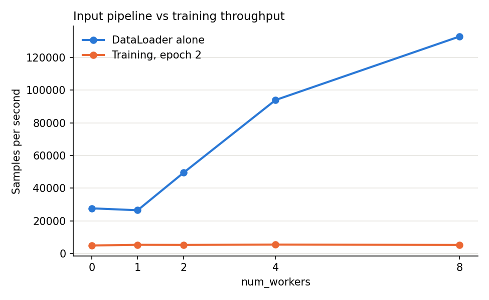
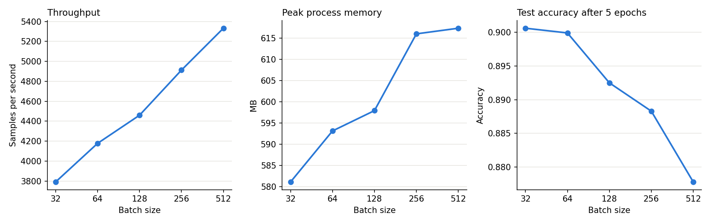
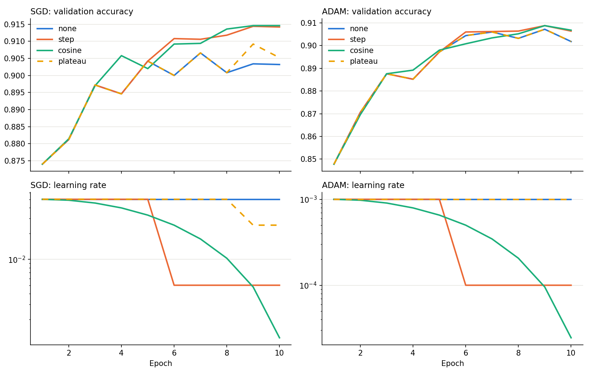
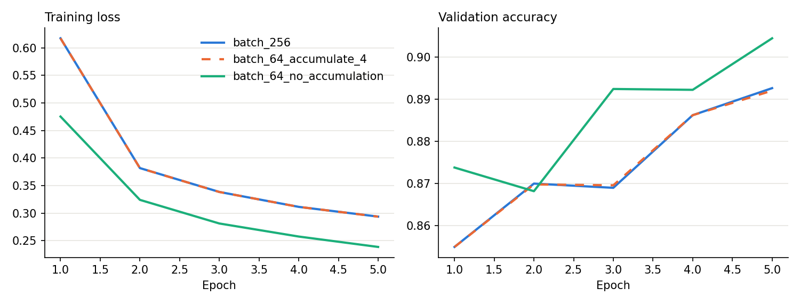
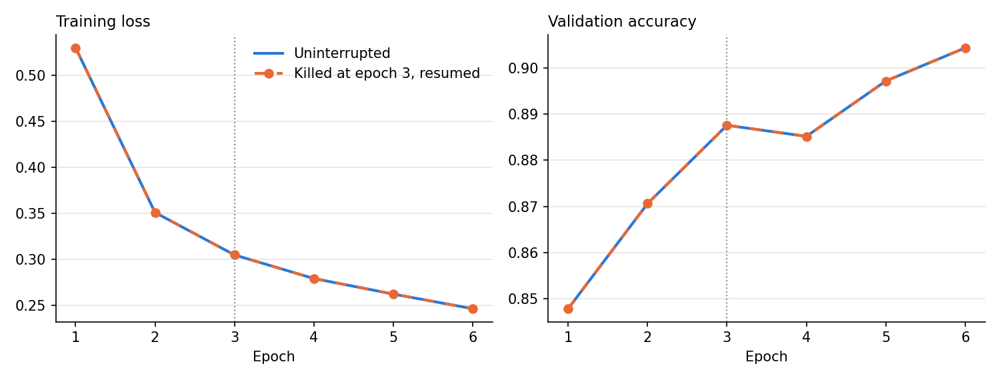
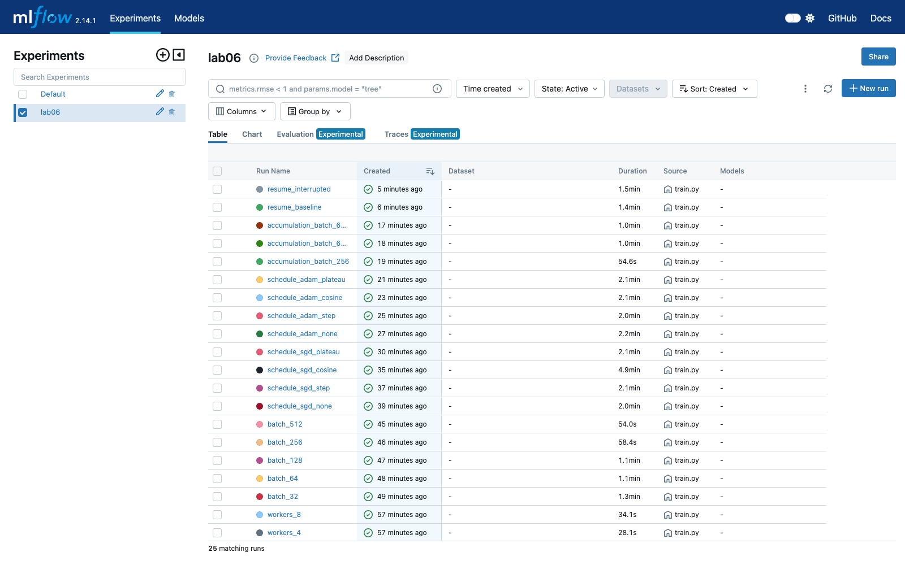
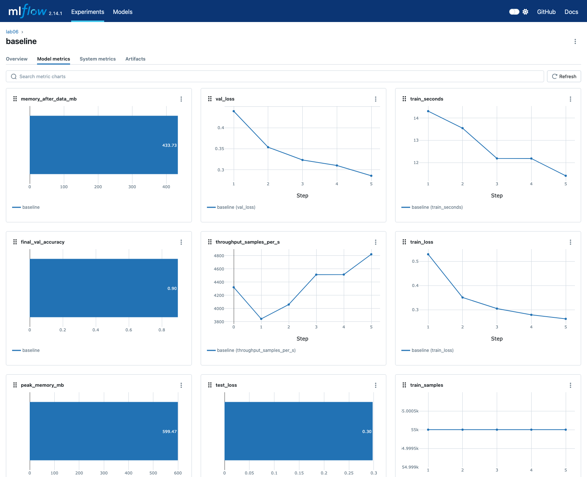

# Lab 6 — Training Pipelines and Project Proposal

## Goal

Turn the Lab 3 CNN training script into a reproducible training pipeline:
one YAML config, fixed seeds, a checkpoint every epoch, exact resume after a
crash and MLflow tracking. Then use the pipeline to profile an epoch and to
study `num_workers`, batch size, learning-rate schedules, optimizers and
gradient accumulation. Task 8 is the individual project proposal in
`proposal.md`.

Sections marked **Measured** contain numbers copied from the CSV files in
`results/`. Sections marked **Explanation** are my reasoning about those
numbers. They fit the data but I did not test every cause separately.

## Environment

- Apple M1 Pro, macOS. All training on the CPU (`device: cpu`).
- Python 3.11.18, PyTorch 2.3.1, torchvision 0.18.1, MLflow 2.14.1,
  NumPy 1.26.4. The full list is in `results/versions.txt`.
- A separate git-ignored environment in `lab06/.venv`, because the repo-root
  `.venv` is Python 3.13 and has no PyTorch.
- Dataset: Fashion-MNIST, 55,000 train / 5,000 validation (seeded
  `random_split`, as in Lab 3) and the official 10,000 test images.
- Model: the Lab 3 CNN, 20,490 parameters, no BatchNorm.
- One run per configuration, seed 42.

## Task coverage

| Task | Requirement | Where | Evidence |
|---|---|---|---|
| 1 | YAML config, seed, checkpoint every epoch, MLflow logging | `configs/base.yaml`, `src/config.py`, `src/train.py` | Baseline run, `tests/test_pipeline.py` |
| 2 | Profile one epoch: data loading, forward, backward, optimizer | `src/profile_epoch.py` | `results/profile_breakdown.csv`, `results/profile_top_ops.txt` |
| 3 | `num_workers` in [0, 1, 2, 4, 8], find the bottleneck | `src/studies.py workers` | `results/workers_study.csv`, `.png` |
| 4 | Batch size in [32 … 512]: throughput, memory, accuracy | `src/studies.py batch` | `results/batch_study.csv`, `.png` |
| 5 | SGD vs Adam × none / Step / Cosine / Plateau | `src/studies.py schedules` | `results/schedule_study.csv`, `schedule_curves.csv`, `.png` |
| 6 | Gradient accumulation equal to a larger batch | `src/studies.py accumulation` | `results/accumulation_study.csv`, `accumulation_curves.csv`, `.png` |
| 7 | Interrupt training and resume from a checkpoint | `src/studies.py resume` | `results/resume_study.csv`, `.png` |
| 8 | One-page project proposal | `proposal.md` | — |
| — | MLflow evidence | `src/studies.py export` | `results/mlflow_runs.csv`, `mlflow_runs.png`, `mlflow_run_detail.png` |

## Pipeline design

| File | Purpose |
|---|---|
| `configs/base.yaml` | Every setting in one place: experiment, data, model, optimizer, scheduler, train, checkpoint, mlflow |
| `src/config.py` | Loads the YAML and applies `--set section.key=value` overrides. An unknown key raises an error instead of being ignored |
| `src/data.py` | Datasets and loaders. The training loader has its own seeded `torch.Generator` |
| `src/model.py` | The Lab 3 CNN |
| `src/train.py` | Training loop, evaluation, checkpoints, resume, MLflow |
| `src/profile_epoch.py` | Task 2 |
| `src/studies.py` | Tasks 3–7 and the MLflow export, each run in a fresh subprocess |
| `tests/test_pipeline.py` | 20 tests on small fake data |

Key decisions:

- **One config object.** Every run is `train.py` with the base YAML plus a
  few `--set` overrides, so a study is just a list of overrides. The full
  resolved config is logged to MLflow as `config.yaml` and its flattened
  keys as parameters.
- **Seeds.** Python, NumPy and PyTorch are seeded, and the training
  loader's shuffle uses its own generator, so two runs with the same config
  give the same numbers.
- **Checkpoints.** After every epoch the pipeline saves `epoch_NNN.pt` and
  `last.pt` with the model, optimizer, scheduler, epoch, history, MLflow
  run ID and every random-number state, including the loader's generator.
  Files are written to a `.tmp` file and then renamed, so a crash during
  the save cannot leave a broken checkpoint.
- **Resume.** `checkpoint.resume=<path>` restores all of that state and
  continues in the **same** MLflow run, so a resumed run has one continuous
  metric history.
- **Gradient accumulation.** Each micro-batch's summed loss is divided by
  the number of samples in its whole accumulation group, not by the
  micro-batch size. That makes the summed gradient equal to the gradient
  of the large batch, including the last, smaller group of an epoch.

## Task 1: baseline run

**Measured** (MLflow run `baseline`, batch 128, Adam lr 0.001, 5 epochs):

| Epoch | Train loss | Val accuracy |
|---:|---:|---:|
| 1 | 0.5295 | 0.8478 |
| 2 | 0.3510 | 0.8706 |
| 3 | 0.3050 | 0.8876 |
| 4 | 0.2794 | 0.8852 |
| 5 | 0.2625 | 0.8972 |

Test accuracy **0.8925**, peak memory 599.47 MB. Lab 3's CNN reached 0.8954
after 5 epochs, so the pipeline version is 0.0029 lower.

**Explanation:** the model, split and seed are the same, but the code that
draws batches and initialises the weights is different, so the exact
random sequence differs. The workers study below shows that a different
batch order alone moves test accuracy by about 0.01, so a 0.003 gap is
within that noise.

The `batch_128` run in Task 4 has the same config and gives the same
numbers (test 0.8925, best val 0.8972), which shows that a fixed seed
reproduces a run exactly.

## Task 2: profile breakdown

**Measured** (`results/profile_breakdown.csv`): one full epoch, 430 batches
of 128, `num_workers=0`, with `torch.profiler` and one `record_function`
label per phase.

| Phase | Profiler time (ms) | Share | Plain-timer share |
|---|---:|---:|---:|
| Backward | 6,675.7 | **52.4%** | 52.4% |
| Forward | 3,092.5 | 24.3% | 24.3% |
| Data loading | 2,784.2 | 21.9% | 21.8% |
| Optimizer step | 182.0 | 1.4% | 1.5% |

Time outside the four phases was 0.75 ms. The profiler and the plain
timers agree to 0.2 percentage points.

From `results/profile_top_ops.txt`: `aten::convolution_backward` is 46.1%
of self CPU time on its own, the forward convolution
(`aten::_nnpack_spatial_convolution`) is 14.2%, and max pooling forward is
7.1%. Single-process data loading
(`_SingleProcessDataLoaderIter`) is 18.1%.

**Explanation:** the bottleneck is compute, mostly the convolution
gradients. Backward costs about twice the forward pass, which is the usual
ratio, because it computes gradients for both the inputs and the weights.
Data loading is the second-largest cost at 22%. That is what extra workers
could hide, which is what Task 3 tests. The optimizer is cheap because the
model has only 20,490 parameters.

## Task 3: num_workers study

**Measured** (`results/workers_study.csv`, batch 128, 2 epochs each).
`loader_only` iterates the training loader with no model. Training
throughput is measured on epoch 2, after the workers have started.

| Workers | Loader only (samples/s) | Loader start-up (s) | Training, epoch 1 (samples/s) | Training, epoch 2 (samples/s) | Loader / training |
|---:|---:|---:|---:|---:|---:|
| 0 | 27,621 | 0.007 | 4,798 | 4,866 | 5.7× |
| 1 | 26,442 | 1.675 | 4,467 | 5,268 | 5.0× |
| 2 | 49,457 | 3.813 | 3,941 | 5,211 | 9.5× |
| 4 | 93,945 | 6.859 | 3,345 | **5,389** | 17.4× |
| 8 | 132,820 | 13.911 | 2,496 | 5,196 | 25.6× |



**Explanation:**

- Even with 0 workers, the loader alone supplies 5.7× more samples per
  second than training uses. So the bottleneck is compute (forward and
  backward), not data loading, which matches Task 2.
- Workers still help a little once they are running: epoch 2 goes from
  4,866 to 5,389 samples/s with 4 workers (+10.7%), because loading moves
  off the main process and overlaps with compute. Going from 4 to 8
  workers gives nothing more (5,196), because there is no data
  bottleneck left to remove.
- Starting workers on macOS is slow (spawn start method): 1.7 s for 1
  worker and 13.9 s for 8. That makes epoch 1 *slower* with more workers
  (2,496 samples/s with 8 workers). For a short run, or a model this small,
  `num_workers=0` or 1–2 is the better choice. `persistent_workers=True`
  pays the start-up cost only once per run.
- The runs with workers end at a different test accuracy from 0 workers
  (0.8762 vs 0.8651, `mlflow_runs.csv`), while all four runs with workers
  agree exactly. So the batch order differs between the single-process and
  multi-process loader paths. I did not trace exactly where. A 0.011 gap
  from batch order alone is a useful estimate of run-to-run noise for the
  other studies.

## Task 4: batch-size study

**Measured** (`results/batch_study.csv`, Adam lr 0.001, 5 epochs).
Memory is the peak resident memory of the whole process (`ru_maxrss`).
`After data` is measured once the datasets are loaded, before training.

| Batch | Throughput (samples/s) | After data (MB) | Peak (MB) | Added by training (MB) | Final val acc | Test acc |
|---:|---:|---:|---:|---:|---:|---:|
| 32 | 3,791 | 433.2 | 581.1 | 147.9 | 0.9004 | **0.9006** |
| 64 | 4,178 | 433.4 | 593.1 | 159.7 | 0.9044 | 0.8999 |
| 128 | 4,460 | 432.7 | 597.9 | 165.2 | 0.8972 | 0.8925 |
| 256 | 4,912 | 434.2 | 616.0 | 181.8 | 0.8926 | 0.8883 |
| 512 | **5,332** | 433.5 | 617.3 | 183.9 | 0.8816 | 0.8778 |



**Explanation:**

- Throughput rises by 41% from batch 32 to 512, because there is less
  Python and per-call overhead per sample and larger matrix operations use
  the CPU better.
- Memory added by training grows only from 148 MB to 184 MB. Activations
  for this small CNN on 28 × 28 images are small; most of the process
  memory is Python, PyTorch and the dataset (about 433 MB before
  training).
- Accuracy falls as the batch grows: 0.9006 at 32 and 0.8778 at 512. The
  learning rate was fixed at 0.001 for every batch size, so batch 512
  makes 16× fewer update steps in 5 epochs than batch 32. With the
  learning rate scaled up for large batches, or more epochs, the gap
  would probably shrink. This study therefore shows a speed/accuracy
  trade-off at a fixed lr and a fixed number of epochs, not that large
  batches are worse in general.

## Task 5: schedules and optimizers

**Measured** (`results/schedule_study.csv`, batch 128, 10 epochs each.
SGD: lr 0.05, momentum 0.9. Adam: lr 0.001. StepLR step 5, gamma 0.1;
Cosine T_max 10; Plateau factor 0.5, patience 1, on validation loss).

| Optimizer | Scheduler | Final train loss | Final val acc | Best val acc | Test acc | Final lr |
|---|---|---:|---:|---:|---:|---:|
| SGD | none | 0.2047 | 0.9032 | 0.9066 | 0.9025 | 0.05 |
| SGD | StepLR | 0.1715 | 0.9142 | 0.9144 | 0.9117 | 0.005 |
| SGD | Cosine | **0.1578** | **0.9146** | **0.9146** | **0.9151** | 0.00122 |
| SGD | Plateau | 0.1734 | 0.9052 | 0.9092 | 0.9024 | 0.025 |
| Adam | none | 0.2079 | 0.9018 | 0.9072 | 0.8989 | 0.001 |
| Adam | StepLR | 0.2195 | 0.9064 | 0.9088 | 0.9009 | 0.0001 |
| Adam | Cosine | 0.2138 | 0.9068 | 0.9088 | 0.9023 | 0.0000245 |
| Adam | Plateau | 0.2079 | 0.9018 | 0.9072 | 0.8989 | 0.001 |



**Explanation:**

- **Winner: SGD with momentum and cosine annealing**, test accuracy
  0.9151, followed by SGD with StepLR (0.9117). Both beat SGD with a
  constant lr (0.9025) by about 1 point. All four Adam runs are between
  0.8989 and 0.9023.
- With SGD, lowering the learning rate late in training clearly helps:
  StepLR's drop to 0.005 after epoch 5 lowers the train loss from 0.2428
  to 0.1904 in one epoch (`schedule_curves.csv`). Cosine lowers the lr
  smoothly and ends with the lowest train loss.
- Adam gains little from the schedules, because it already adapts its step
  size per parameter.
- Adam + Plateau is identical to Adam with no schedule. Validation loss
  improved every epoch from 1 to 9, so it never had 2 bad epochs in a row
  and the lr never dropped. SGD + Plateau dropped the lr to 0.025 only
  after epochs 7 and 8 were both worse than epoch 6, which was too late to
  help.
- SGD none, StepLR and Plateau have identical numbers for epochs 1–5,
  because the lr is the same until then and the pipeline is deterministic.
- **Noise:** this is one seed per configuration. The workers study showed
  that batch order alone moves test accuracy by about 0.011. The 1-point
  gain of SGD + cosine or StepLR over the other runs is about the same
  size, so the ranking is a good sign but not proven. Several seeds per
  configuration would be needed to be sure.

## Task 6: gradient accumulation

**Measured** (`results/accumulation_study.csv`, Adam lr 0.001, 5 epochs).

| Run | Optimizer steps / epoch | Final train loss | Test acc | Throughput (samples/s) | Max \|train loss diff\| vs batch 256 |
|---|---:|---:|---:|---:|---:|
| Batch 256 | 215 | 0.293711 | 0.8883 | 5,273 | 0 |
| Batch 64 × accumulate 4 | 215 | 0.293614 | 0.8891 | 4,759 | **9.6e-05** |
| Batch 64, no accumulation (control) | 860 | 0.238614 | 0.8999 | 4,669 | 0.142 |



**Explanation:**

- Batch 64 with 4 accumulation steps makes the same 215 optimizer steps
  per epoch as batch 256, and its train loss matches batch 256 within
  9.6e-05 in every epoch. The control without accumulation is a different
  training run (860 steps, loss difference 0.142).
- The match is close but not exact to the last digit, because adding four
  partial gradients in floating point gives slightly different rounding
  than one large sum. The CNN has no BatchNorm, so no statistic depends on
  the micro-batch size.
- Accumulation is 9.8% slower than one real batch of 256, because each
  small batch does less work per call. Its use is memory: it gives the
  training result of a large batch while holding activations for only
  64 samples at a time.

## Task 7: interrupt and resume

**Measured** (`results/resume_study.csv`). `resume_baseline` trains 6
epochs without stopping. `resume_interrupted` trains the same config, is
killed with `SIGKILL` as soon as `epoch_003.pt` exists, and is then
resumed from that file in the same MLflow run.

| Epoch | Segment | Baseline train loss | Resumed train loss | Baseline val acc | Resumed val acc | \|Diff\| |
|---:|---|---:|---:|---:|---:|---:|
| 1 | before interruption | 0.529491 | 0.529491 | 0.8478 | 0.8478 | 0.0 |
| 2 | before interruption | 0.350975 | 0.350975 | 0.8706 | 0.8706 | 0.0 |
| 3 | before interruption | 0.304954 | 0.304954 | 0.8876 | 0.8876 | 0.0 |
| 4 | after resume | 0.279368 | 0.279368 | 0.8852 | 0.8852 | 0.0 |
| 5 | after resume | 0.262511 | 0.262511 | 0.8972 | 0.8972 | 0.0 |
| 6 | after resume | 0.246649 | 0.246649 | 0.9044 | 0.9044 | 0.0 |

Both runs end at test accuracy 0.8952 (`mlflow_runs.csv`).



**Explanation:** the resumed run is bit-for-bit identical to the run that
was never stopped. Restoring only the model and optimizer would not be
enough. The checkpoint also restores the scheduler and the random-number
states, including the training loader's shuffle generator, so epochs 4–6
see the same batches in the same order. `SIGKILL` cannot be caught, so
this is a fair test of a real crash. It works because each checkpoint is
fully written before the rename makes it visible.

## MLflow runs

All 25 runs are in the `lab06` experiment (store in `lab06/mlruns`, not
committed). `results/mlflow_runs.csv` lists every run with its main
parameters and metrics.

Run list:



Metric charts of the baseline run:



Each run has the flattened config as parameters, per-epoch `train_loss`,
`train_accuracy`, `val_loss`, `val_accuracy`, `lr` and throughput,
summary metrics (`test_accuracy`, `best_val_accuracy`, `peak_memory_mb`)
and the artifacts `config.yaml`, `history.csv` and `last.pt`.

## Tests

`tests/test_pipeline.py` has 20 tests on small fake data:

- config loading and overrides;
- the model parameter count;
- seed reproducibility;
- checkpoint contents;
- MLflow logging;
- the profiler phases;
- every optimizer and scheduler;
- accumulation equivalence;
- exact resume.

All 20 pass.

## Limitations

- CPU only, on one machine (M1 Pro). Throughput and the worker start-up
  costs would be different on a GPU or Linux, where workers are started by
  fork.
- One seed per configuration, so small differences (about 1 point of
  accuracy) are not proven to be real.
- Task 4 keeps the learning rate fixed at 0.001, which is unfair to large
  batches.
- Peak memory comes from `ru_maxrss` for the whole process. It cannot go
  down during a run, and it includes Python and the dataset.
- Short runs (5–10 epochs). None of the models has fully converged.
- In the profile, the profiler adds some overhead to every operation. The
  shares agree with the plain timers, but absolute times are slightly
  higher than without the profiler.

## Conclusions

1. The pipeline is reproducible: the same config gives the same numbers
   (baseline = `batch_128`), and a run killed at epoch 3 and resumed ends
   identical to an uninterrupted run (difference 0.0).
2. Training this CNN is compute-bound. Backward is 52% of the epoch, and
   the loader alone is 5.7× faster than training even with 0 workers.
   Workers give at most +10.7% once started but cost up to 13.9 s to start
   on macOS.
3. Larger batches are faster (+41% from 32 to 512) and add little memory,
   but at a fixed lr they reach lower accuracy in the same number of
   epochs.
4. SGD with momentum and a decaying lr (cosine 0.9151, StepLR 0.9117) gave
   the best test accuracy. Adam was less sensitive to the schedule.
5. Gradient accumulation reproduces the large-batch result (loss within
   9.6e-05) at about 10% lower speed, and uses only small-batch memory.

## Reproducing

From the repository root, with `P=lab06/.venv/bin/python`:

```bash
$P -m pytest lab06/tests -q
$P lab06/src/train.py --set experiment.run_name=baseline train.epochs=5
$P lab06/src/profile_epoch.py
$P lab06/src/studies.py workers
$P lab06/src/studies.py batch
$P lab06/src/studies.py schedules
$P lab06/src/studies.py accumulation
$P lab06/src/studies.py resume
$P lab06/src/studies.py export
lab06/.venv/bin/mlflow ui --backend-store-uri lab06/mlruns
```

## Outputs

| File | Content |
|---|---|
| `results/profile_breakdown.csv` | Task 2 phase times and shares |
| `results/profile_top_ops.txt` | Task 2 top 25 operations |
| `results/workers_study.csv`, `.png` | Task 3 |
| `results/batch_study.csv`, `.png` | Task 4 |
| `results/schedule_study.csv`, `schedule_curves.csv`, `.png` | Task 5 |
| `results/accumulation_study.csv`, `accumulation_curves.csv`, `.png` | Task 6 |
| `results/resume_study.csv`, `.png` | Task 7 |
| `results/mlflow_runs.csv`, `mlflow_runs.png`, `mlflow_run_detail.png` | MLflow evidence |
| `results/versions.txt` | Package versions |
| `proposal.md` | Task 8 project proposal |
