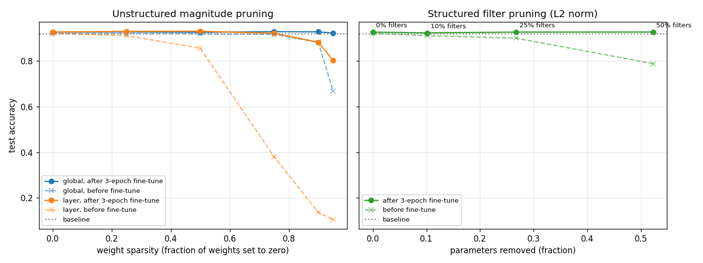
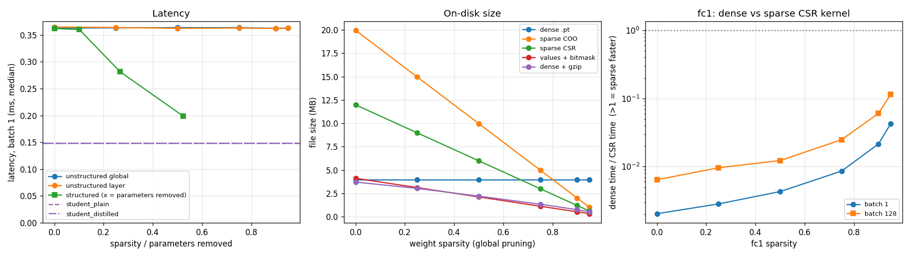
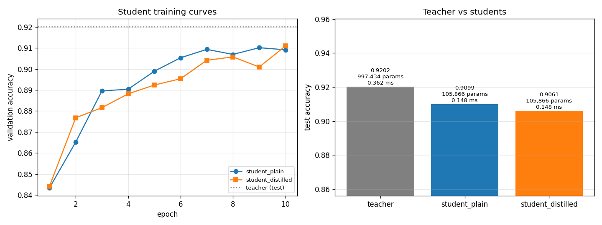

# Lab 7 — Compression: Pruning and Distillation

## Goal

Start from an oversized CNN, shrink it in two ways and check what actually
improves:

- **Pruning:** set the smallest weights to zero (unstructured), or remove
  whole filters (structured).
- **Distillation:** train a small student to copy the big model.

The lab asks for an honest look at the difference between a model that is
*smaller on paper* and one that is *faster on real hardware*.

Sections marked **Measured** contain numbers copied from the CSV files in
`results/`. Sections marked **Explanation** are my reasoning about those
numbers.

## Environment

- Apple M1 Pro, macOS, CPU only.
- Python 3.11.18, PyTorch 2.3.1, torchvision 0.18.1, NumPy 1.26.4. The full
  list is in `results/versions.txt`. Environment: `lab06/.venv`.
- Fashion-MNIST with the same 55,000 / 5,000 split, seed (42) and
  normalisation as Labs 3 and 6, plus the 10,000 official test images.
- Training: Adam, batch 128, on PyTorch's default of 8 CPU threads. Baseline lr 1e-3,
  fine-tuning lr 5e-4.
- **Latency:** median of 200 calls after 20 warm-up calls, on **1 CPU
  thread** (`torch.set_num_threads(1)`), at batch 1. Throughput is
  measured at batch 128, also on 1 thread.
- All latency and throughput numbers in this report come from one run of
  `latency.py`, which measures every model in the same process after a
  discarded warm-up measurement.

## Task coverage

| Task | Marks | Requirement | Where | Evidence |
|---|---:|---|---|---|
| 1 | 15 | Oversized baseline CNN, ~1M params: accuracy, params, size, latency | `src/baseline.py`, `src/models.py` | `results/baseline.csv`, `baseline_history.csv` |
| 2 | 35 | Magnitude pruning, global and per layer, at 0–0.95; fine-tune 3 epochs with fixed mask; structured filter pruning at 10/25/50%; plot | `src/prune.py` | `results/pruning_unstructured.csv`, `pruning_structured.csv`, `pruning_global_layer_sparsity.csv`, `pruning_curves.png` |
| 3 | 15 | Latency; dense vs sparse size on disk; why unstructured sparsity rarely speeds up dense CPU kernels | `src/latency.py` | `results/latency_size.csv`, `sparse_kernel_benchmark.csv`, `latency_size.png` |
| 4 | 30 | Distillation, teacher = baseline, student ~100k, T = 4, alpha = 0.5, with and without teacher | `src/distill.py` | `results/distillation.csv`, `distillation_curves.csv`, `distillation.png` |
| 5 | 20 | One table by Ch. 9 pillars (data, model, compute, energy) and a conclusion | `src/summary.py` | `results/efficiency_summary.csv`, `efficiency_summary.md` |

**Graded evidence:**

- sparsity curves: Task 2;
- honest latency analysis: Task 3;
- distillation vs plain student: Task 4.

## Models

| Model | Layers | Parameters |
|---|---|---:|
| TeacherCNN (baseline) | conv 1→32, pool, conv 32→64, pool, conv 64→128, fc 6,272→144, dropout 0.3, fc 144→10 | 997,434 |
| StudentCNN | conv 1→16, pool, conv 16→32, pool, fc 1,568→64, fc 64→10 | 105,866 |

In the teacher, `fc1` holds 903,312 of the 997,434 parameters (90.6%) but
only 903,168 of the 8,355,744 MACs per image (10.8%). The conv layers are
the other way round: few parameters, most of the compute. This matters for
everything below.

## Task 1: Baseline

**Measured** (`results/baseline.csv`, 10 epochs; latency and throughput
from `results/latency_size.csv`):

| Metric | Value |
|---|---:|
| Parameters | 997,434 |
| Size (float32 state_dict) | 3.99 MB |
| Test accuracy | **0.9202** |
| MACs per image | 8,355,744 |
| Latency, batch 1, 1 thread | 0.364 ms |
| Throughput, batch 128, 1 thread | 2,525 samples/s |
| Training time | 303.0 s |

Validation accuracy peaked at 0.9308 in epoch 8 and ended at 0.9262. Train
loss kept falling (0.1132 in epoch 10), while validation loss was lowest in
epoch 6 (0.2010) and then rose (0.2275 in epoch 10). So the big model
starts to overfit after about 6 epochs (`baseline_history.csv`).

## Task 2: Unstructured magnitude pruning

Method (`src/prune.py`):

- Every conv and linear weight is ranked by absolute value, and the
  smallest are set to zero with `torch.nn.utils.prune`. Biases are not
  pruned.
- **Global:** one threshold over all layers together.
- **Per layer:** the same fraction in every layer.
- Each model is then fine-tuned for 3 epochs. The mask is fixed:
  `weight = weight_orig * mask`, so the gradient of a pruned weight is
  multiplied by 0 and it stays zero. A test checks this.

**Measured** (`results/pruning_unstructured.csv`, test accuracy):

| Sparsity | Non-zero params | Global, before FT | Global, after FT | Per layer, before FT | Per layer, after FT |
|---:|---:|---:|---:|---:|---:|
| 0 | 997,434 | 0.9202 | 0.9261 | 0.9202 | 0.9268 |
| 0.25 | 748,170 | 0.9207 | 0.9275 | 0.9110 | 0.9294 |
| 0.5 | 498,906 | 0.9189 | 0.9256 | 0.8555 | 0.9302 |
| 0.75 | 249,642 | 0.9164 | 0.9283 | 0.3804 | 0.9210 |
| 0.9 | 100,084 | 0.8810 | **0.9275** | 0.1358 | 0.8823 |
| 0.95 | 50,231 | 0.6683 | **0.9221** | 0.1053 | 0.8025 |

**Measured** (`results/pruning_global_layer_sparsity.csv`): where global
pruning took the weights from.

| Global target | conv1 (288) | conv2 (18,432) | conv3 (73,728) | fc1 (903,168) | fc2 (1,440) |
|---:|---:|---:|---:|---:|---:|
| 0.5 | 0.052 | 0.198 | 0.233 | 0.529 | 0.131 |
| 0.75 | 0.090 | 0.477 | 0.547 | 0.773 | 0.344 |
| 0.9 | 0.181 | 0.711 | 0.784 | 0.914 | 0.656 |
| 0.95 | 0.243 | 0.816 | 0.878 | 0.959 | 0.755 |

## Task 2: Structured filter pruning

Method:

- In each conv layer, the filters with the smallest L2 norm are removed:
  10%, 25% or 50% of the filters, with 0% as a reference.
- The model is really rebuilt smaller. Removing output filter *j* of one
  conv also removes input channel *j* of the next conv, and for `conv3` the
  49 matching input columns of `fc1`.
- A test checks that the smaller model gives the same output as the
  original with those filters set to zero.
- Then the model is fine-tuned for 3 epochs.

**Measured** (`results/pruning_structured.csv`):

| Filters removed | Channels | Parameters | Parameters removed | Before FT | After FT |
|---:|---|---:|---:|---:|---:|
| 0% | 32-64-128 | 997,434 | 0.0% | 0.9202 | 0.9264 |
| 10% | 29-58-116 | 896,244 | 10.1% | 0.9107 | 0.9230 |
| 25% | 24-48-96 | 731,194 | 26.7% | 0.9000 | 0.9265 |
| 50% | 16-32-64 | 476,474 | 52.2% | 0.7883 | **0.9268** |



**Explanation:**

- **Compare against the fine-tuned 0% models, not the baseline.** At 0%
  sparsity, the 3 extra epochs alone raise test accuracy from 0.9202 to
  about 0.926 (0.9261, 0.9268, 0.9264). So "pruned model beats the
  baseline" is mostly extra training. The fair statement is that global
  pruning up to 90% loses nothing compared with the same extra training
  (0.9275 vs 0.9261), and at 95% it loses 0.4 points.
- **Global beats per layer at high sparsity** (0.9221 vs 0.8025 at 95%).
  Global pruning spends the sparsity where weights are redundant: fc1 is
  95.9% zero at the 95% target, while conv1 is only 24.3% zero. Per-layer
  pruning removes 95% of conv1 as well, leaving 14 of its 288 weights. The
  first layer then cannot extract enough features, and fine-tuning cannot
  repair that.
- **Before fine-tuning**, per-layer pruning collapses already at 75%
  (0.3804), while global pruning still has 0.9164. Global pruning removes
  smaller weights overall, so each step does less damage.
- **Structured pruning** is harsher before fine-tuning (0.7883 at 50%) but
  recovers fully (0.9268) with half the parameters. One run per setting,
  so differences of about 0.003 between the after-FT numbers are within
  noise.

## Task 3: Latency and size

**Measured** (`results/latency_size.csv`; global pruning shown, per-layer
pruning has the same latencies and sizes):

| Model | Weight sparsity | Latency b1 (ms) | Throughput b128 (samples/s) | Dense .pt (MB) | COO (MB) | CSR (MB) | Values + bitmask (MB) | Dense + gzip (MB) | MACs dense | MACs non-zero |
|---|---:|---:|---:|---:|---:|---:|---:|---:|---:|---:|
| baseline | 0 | 0.364 | 2,525 | 3.99 | 19.95 | 11.98 | 4.12 | 3.71 | 8,355,744 | 8,355,744 |
| global 0.25 | 0.25 | 0.363 | 2,526 | 3.99 | 14.96 | 8.98 | 3.12 | 3.04 | 8,355,744 | 7,490,265 |
| global 0.5 | 0.5 | 0.364 | 2,532 | 3.99 | 9.98 | 5.99 | 2.12 | 2.20 | 8,355,744 | 6,311,361 |
| global 0.75 | 0.75 | 0.364 | 2,526 | 3.99 | 4.99 | 3.00 | 1.13 | 1.35 | 8,355,744 | 3,936,801 |
| global 0.9 | 0.9 | 0.362 | 2,525 | 3.99 | 2.00 | 1.21 | 0.53 | 0.76 | 8,355,744 | 2,085,289 |
| global 0.95 | 0.95 | 0.363 | 2,522 | 3.99 | 1.00 | 0.61 | 0.33 | 0.53 | 8,355,744 | 1,316,507 |
| structured 10% | 0 | 0.360 | 3,157 | 3.59 | — | — | — | 3.33 | 6,958,656 | 6,958,656 |
| structured 25% | 0 | 0.281 | 3,917 | 2.93 | — | — | — | 2.72 | 4,912,416 | 4,912,416 |
| structured 50% | 0 | **0.199** | 6,477 | 1.91 | — | — | — | 1.78 | 2,372,256 | 2,372,256 |

**Measured** (`results/sparse_kernel_benchmark.csv`): `fc1` (144 × 6,272)
alone, dense `W @ x` against `torch.sparse.mm` with a CSR matrix, 1 thread.

| fc1 sparsity | Batch 1 dense (ms) | Batch 1 CSR (ms) | Batch 128 dense (ms) | Batch 128 CSR (ms) |
|---:|---:|---:|---:|---:|
| 0 | 0.0228 | 11.208 | 0.1454 | 22.706 |
| 0.5 | 0.0240 | 5.599 | 0.1509 | 11.964 |
| 0.75 | 0.0240 | 2.799 | 0.1464 | 6.324 |
| 0.9 | 0.0241 | 1.123 | 0.1453 | 2.603 |
| 0.95 | 0.0240 | 0.563 | 0.1453 | 1.317 |



**Explanation, latency:**

- Unstructured pruning gives **no speed-up at all**. Latency stays at
  0.362–0.364 ms from 0% to 95% sparsity, for both global and per-layer
  pruning. The zeros are still stored as float32 numbers and still
  multiplied.
- Structured pruning **does** speed up: removing 50% of the filters cuts
  latency from 0.364 to 0.199 ms (−45%) and raises batch-128 throughput
  2.6×. The layers really are smaller, so the dense kernels do less work.
  10% of the filters gives no batch-1 gain (0.360 ms) but +25% throughput
  at batch 128. At batch 1, fixed per-call overhead hides the small saving.

**Explanation, size:**

- The normal dense `.pt` file is 3.99 MB at every sparsity, because a zero
  takes 4 bytes like any other float.
- PyTorch's sparse formats store an int64 index per non-zero: COO 20 bytes
  per non-zero, CSR 12. They are **larger** than dense until high sparsity:
  CSR breaks even at about 67% (3.00 MB at 75%) and COO at about 80%
  (2.00 MB at 90%).
- Values + a 1-bit mask costs 4 bytes per non-zero plus 1/8 byte per weight.
  It is 3% larger than dense at 0% but smaller at any real sparsity:
  0.53 MB at 90%, 7.5× smaller.
- gzip of the dense file gives a similar result (0.76 MB at 90%) with no
  special format.
- So pruning helps **storage and download size**, but only when the file
  is written in a suitable format. It does not help memory or speed at run
  time with dense kernels.

### Why unstructured sparsity rarely speeds up dense CPU kernels

1. **Dense kernels do not look at the values.** BLAS and NNPACK (used here
   for conv) run the same fixed loops of fused multiply-adds over every
   element. A zero costs exactly as much as any other number. That is why
   latency is flat in the table above.
2. **Sparse kernels pay for every non-zero in overhead.** For each
   non-zero they must read its index and then fetch the matching input
   from an irregular address. That breaks SIMD vectorisation, prefetching
   and cache reuse, which is where dense kernels get their speed. On this
   CPU, the CSR multiply of `fc1` is **491× slower** than dense at 0%
   sparsity and still **23× slower** at 95% (9× at batch 128). Dense
   matrix multiply is so efficient that the sparse kernel cannot catch up
   even with 20× less arithmetic.
3. **The sparsity is in the wrong place.** Global pruning takes most of its
   zeros from `fc1`, which has 90.6% of the parameters but only 10.8% of
   the MACs. At 90% weight sparsity, a *perfect* sparse kernel would still
   do 2,085,289 MACs, 25% of dense, not 10%.
4. **Irregular patterns cannot be skipped in blocks.** Hardware speeds up
   only regular sparsity: whole filters or channels (structured pruning,
   shown above), or fixed patterns such as 2:4 sparsity on GPUs that
   support it. Random scattered zeros give the hardware nothing to skip.

## Task 4: Knowledge distillation

Method (`src/distill.py`):

- Teacher: the trained baseline (0.9202 test accuracy).
- Student: StudentCNN (105,866 parameters, 9.4× fewer than the teacher).
- Two students, each trained for 10 epochs from the **same initial
  weights** and with the **same batch order**:
  - Plain: `CE(student, labels)`.
  - Distilled: `alpha · CE(student, labels) + (1 − alpha) · T² · KL`,
    with T = 4 and alpha = 0.5.
- The KL term is implemented as `F.kl_div(log_softmax(student/T),
  softmax(teacher/T))`, which computes KL(p_teacher ‖ p_student), the
  standard Hinton form. A test checks it against the formula written out
  by hand.

**Measured** (`results/distillation.csv`; latency, throughput and size
from `results/latency_size.csv`):

| Model | Parameters | Size (MB) | Test accuracy | Test loss | Latency b1 (ms) | Throughput b128 | Training time |
|---|---:|---:|---:|---:|---:|---:|---:|
| Teacher | 997,434 | 3.99 | 0.9202 | 0.2496 | 0.364 | 2,525 | 303.0 s |
| Plain student | 105,866 | 0.43 | **0.9099** | 0.2520 | 0.148 | 9,037 | 132.9 s |
| Distilled student | 105,866 | 0.43 | 0.9061 | 0.2963 | 0.149 | 9,096 | 232.4 s |

**Measured** (`results/distillation_curves.csv`), validation accuracy by
epoch:

| Epoch | 1 | 2 | 3 | 4 | 5 | 6 | 7 | 8 | 9 | 10 |
|---|---:|---:|---:|---:|---:|---:|---:|---:|---:|---:|
| Plain | 0.8434 | 0.8652 | 0.8896 | 0.8904 | 0.8990 | 0.9054 | 0.9094 | 0.9070 | 0.9102 | 0.9092 |
| Distilled | 0.8442 | 0.8768 | 0.8816 | 0.8882 | 0.8924 | 0.8954 | 0.9042 | 0.9058 | 0.9010 | 0.9110 |



**Explanation:**

- **Distillation did not help in this run.** The distilled student's test
  accuracy is 0.38 points *lower* than the plain student's (0.9061 vs
  0.9099), although its final validation accuracy is 0.18 points *higher*
  (0.9110 vs 0.9092). The two signs disagree and both gaps are small, so
  with one seed per model the honest conclusion is **no measurable
  difference**, not "distillation is worse".
- Both students have the same size and the same latency (0.148 vs
  0.149 ms). Distillation changes only how the weights are trained, not
  the model. Both students are 2.4× faster than the teacher at batch 1 and
  9.4× smaller, for 1.0–1.4 points less accuracy.
- Possible reasons the teacher added little:
  - The teacher is only 1.0 point better than the plain student, so its
    soft labels carry little extra information.
  - Fashion-MNIST labels are clean, so hard labels are already a good
    target.
  - T = 4 and alpha = 0.5 were fixed by the lab, not tuned.
  - The teacher overfits a little (Task 1), and its softened outputs pass
    some of that on.
- The higher test *loss* of the distilled student (0.2963 vs 0.2520) is
  expected. It was trained to match the teacher's softened distribution at
  T = 4, so its probabilities at T = 1 are less sharp than a model trained
  only on cross-entropy.
- Distillation costs training compute. Each epoch also runs the teacher
  forward, so an epoch takes 21.5–24.9 s instead of 12.5–13.8 s, and it
  needs the 303 s teacher first.

## Task 5: Efficiency summary by Chapter 9 pillar

**Measured**, except the energy rows (`results/efficiency_summary.md`).

| Pillar | Metric | Baseline | Global pruned 90% | Structured 50% filters | Plain student | Distilled student |
|---|---|---:|---:|---:|---:|---:|
| quality | test accuracy | 0.9202 | 0.9275 | 0.9268 | 0.9099 | 0.9061 |
| data | training samples seen, incl. the baseline it depends on | 550,000 | 715,000 | 715,000 | 550,000 | 1,100,000 |
| data | needs the trained baseline | no | yes (prunes it) | yes (prunes it) | no | yes (soft labels) |
| model | parameters stored | 997,434 | 997,434 | 476,474 | 105,866 | 105,866 |
| model | non-zero parameters | 997,434 | 100,084 | 476,474 | 105,866 | 105,866 |
| model | size, dense float32 (MB) | 3.99 | 3.99 | 1.91 | 0.43 | 0.43 |
| model | size, best sparse format (MB) | 4.12 | 0.53 | 1.97 | 0.44 | 0.44 |
| model | size, dense + gzip (MB) | 3.71 | 0.76 | 1.78 | 0.40 | 0.40 |
| compute | MACs per image, dense kernels | 8,355,744 | 8,355,744 | 2,372,256 | 1,117,056 | 1,117,056 |
| compute | MACs per image, ideal sparse kernel | 8,355,744 | 2,085,289 | 2,372,256 | 1,117,056 | 1,117,056 |
| compute | latency, batch 1, 1 thread (ms) | 0.364 | 0.362 | 0.199 | 0.149 | 0.149 |
| compute | throughput, batch 128, 1 thread (samples/s) | 2,525 | 2,525 | 6,477 | 9,037 | 9,096 |
| compute | training time incl. baseline (s) | 303.0 | 393.2 | 364.1 | 132.9 | 535.4 |
| energy | inference energy per image (mJ, **estimate**, 5 W) | 1.82 | 1.81 | 1.00 | 0.74 | 0.74 |
| energy | inference energy relative to baseline (latency ratio) | 1.00 | 0.99 | 0.55 | 0.41 | 0.41 |
| energy | training energy (kJ, **estimate**, 20 W) | 6.06 | 7.86 | 7.28 | 2.66 | 10.71 |

**Energy is not measured.** macOS gives no per-process energy counter
without administrator rights. The energy rows are time × an *assumed*
constant power: 5 W for 1-thread inference, 20 W for training. The
absolute values are only as good as these assumptions. The relative row
depends only on measured latency and assumes the same power for every
model, which is reasonable because they all run the same kind of dense
kernels on one core.

**Conclusion:**

- **Data:** none of the methods saves data. Pruning and distillation both
  *start from* the trained baseline, so their real cost includes it. The
  distilled student is the most data-hungry: 1.1M sample passes and
  10.7 kJ, against 2.7 kJ for the plain student.
- **Model:** unstructured pruning makes the stored model smallest (0.53 MB
  at 90% with a bitmask format, 0.33 MB at 95%), but only on disk. In
  memory it is still 3.99 MB of dense floats. Structured pruning and
  the students are genuinely small at run time.
- **Compute:** only *real* reductions in layer size lower latency.
  Structured pruning gives −45%, and the students −59%. Unstructured
  sparsity cuts the theoretical MACs by 75% but the measured latency by 0%,
  and the sparse kernel is slower than dense on this CPU.
- **Energy:** inference energy follows latency, so it follows the same
  ranking as compute. Unstructured pruning saves none.

For deployment on a CPU, the best trade-off here is the **plain student**:
2.4× faster, 9.4× smaller and 1.0 point less accurate than the baseline,
and cheapest to train. If the accuracy loss is too large, **structured
pruning of 50% of the filters** keeps full accuracy (0.9268) at 45% lower
latency. Unstructured pruning is useful only to shrink the download size.

## Tests

`tests/test_compression.py` has 25 tests on random data. They cover:

- the parameter counts of both models;
- that global pruning hits the target and removes the smallest weights;
- equal per-layer sparsity, and uneven sparsity across layers for global
  pruning;
- that the mask stays fixed during fine-tuning;
- that structured pruning equals zeroing the removed filters;
- that the sparse formats round-trip;
- when the sparse files are smaller;
- MAC counts;
- the latency function;
- the distillation loss against the formula;
- an end-to-end run of every script.

All 25 pass.

## Limitations

- **One seed per configuration.** Accuracy differences under about 0.5
  points (for example plain vs distilled student, or the fine-tuned pruning
  results between 0.921 and 0.930) are not proven to be real.
- **CPU only, one machine.** On a GPU with 2:4 sparsity support, or with a
  dedicated sparse inference engine, unstructured sparsity could give some
  speed-up. This report shows only that it gives none with PyTorch dense
  kernels and `torch.sparse` on an M1 Pro CPU.
- **Latency is on 1 thread** to keep it stable. Multi-threaded latency
  would be lower, and the ratios could differ.
- **Speed measurements from different processes disagreed.** Batch-1
  latency matched everywhere (about 0.36 ms for the baseline), but batch-128
  throughput measured inside the training scripts (`baseline.csv`,
  `distillation.csv`) was about 50% higher than in `latency.py` (3,793 vs
  about 2,500 samples/s for the baseline). I did not find the cause, so
  this report uses only `latency.py` numbers, which come from one process
  under the same conditions.
- **Energy is estimated**, not measured (see Task 5).
- The pruned models got 3 more epochs than the baseline. The 0%-sparsity
  fine-tuned models are the fair reference, and the report compares
  against them.
- T and alpha were fixed by the lab and not tuned.

## Reproducing

From the repository root, with `P=lab06/.venv/bin/python`:

```bash
$P -m pytest lab07/tests -q
$P lab07/src/baseline.py
$P lab07/src/prune.py
$P lab07/src/distill.py
$P lab07/src/latency.py
$P lab07/src/summary.py
```

The trained models go to `lab07/checkpoints/`, which is git-ignored.
Running the scripts again gives the same accuracies (fixed seed) but new
timings.

## Outputs

| File | Content |
|---|---|
| `results/baseline.csv`, `baseline_history.csv` | Task 1 |
| `results/pruning_unstructured.csv` | Task 2, global and per-layer pruning |
| `results/pruning_global_layer_sparsity.csv` | Task 2, sparsity per layer |
| `results/pruning_structured.csv` | Task 2, filter pruning |
| `results/pruning_curves.png` | Task 2, sparsity curves |
| `results/latency_size.csv`, `latency_size.png` | Task 3, latency, size, MACs for every model |
| `results/sparse_kernel_benchmark.csv` | Task 3, dense vs CSR kernel |
| `results/distillation.csv`, `distillation_curves.csv`, `distillation.png` | Task 4 |
| `results/efficiency_summary.csv`, `efficiency_summary.md` | Task 5 |
| `results/versions.txt` | Package versions |
